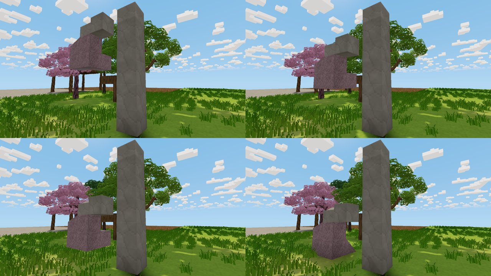

# Falling blocks

Any group of blocks that loses its connection to the ground falls straight
down until it lands on support. It keeps its exact shape and lands an exact
whole number of cells lower. This applies equally to trees, rock outcrops and
building pieces. Nothing tips over, rotates or breaks apart. The code is in
`src/falling.rs`, with hooks in `app.rs`.

Setting: *Settings → Gameplay → Falling blocks* (on by default; the host's
setting decides).

The earlier physics-based tree felling (trees toppling sideways and settling
on the nearest grid orientation) is saved on the `falling-trees-physics`
branch, along with its write-up and its Rapier-ready `FallPhysics` trait.

The images above, in reading order, are 0.01 s, 0.35 s, 0.5 s and 3 s after a
stone arm and its granite block were cut from their post. They fell straight
down and landed three cells lower in the same shape. Render with
`VOXEL_TREE_PREVIEW=on VOXEL_FALL_PREVIEW=<seconds> cargo test --release render_weather_previews -- --ignored --nocapture`.

## What holds things up

After any host edit removes a solid block (by player, rule, script or water),
the system runs a support check on the solid groups next to that cell.

- **Groups.** A group is all solid blocks connected through faces. Leaves,
  wood and stone all count, so a tree is held by its trunk and anything
  touching a supported structure is held by it. Plants and water are not
  structure.
- **Anchored.** A group stays put if it touches the world floor, an
  unbreakable block, an automation device or campfire, or the edge of loaded
  terrain.
- **Too big to fall.** A group also stays put if the search reaches 4096
  blocks. Digging into a hillside therefore never drops the hill.
- **Riders.** Plants standing on a falling group ride along with it.

At most eight groups fall at once. Any others wait in a queue, still in place.

## Falling and landing

- **Detaching.** A detached group's cells are cleared with ordinary edits, and
  one body takes over all of them.
- **Falling.** The body accelerates under gravity (20 cells/s², at most 30
  cells/s), checking each whole cell on the way down so it can't tunnel
  through thin floors.
- **Landing.** It lands as soon as the next cell below any part of it is
  solid. It is placed back with ordinary edits, exactly that many cells
  lower.
- **What it becomes.** Branch blocks become their species' wood. Like any
  edited blocks, the landed group is ordinary construction material, so a
  dropped tree loses its living look (round trunk, swaying crown).
- **Crushing.** Plants in the landing cells are crushed into one item drop
  with exact counts. Water in the way is displaced.
- **Players.** A player in the way holds the body up. It rests on their head
  and continues falling when they step away.
- **Two bodies.** Bodies landing in the same frame never overlap.
- **Nothing below.** A body with only the bottom of the world beneath it
  becomes one item drop with exactly one existing yield per block.

## Saving and multiplayer

- **Saving.** Before the host saves (F5 or on exit), every falling body lands
  at once at the lowest level it can reach.
- **Host authority.** The host decides support, falling and landing.
  - Clients get a reliable `FallingSpawn` with the group's blocks and pose
    (the largest group fits in one packet).
  - Poses arrive in every snapshot, and `FallingEnd` arrives when the body
    lands.
  - The block edits and any drop arrive through the existing channels.
- **Late join.** Players who join mid-fall get a spawn for every active body.

## Validation

Tests in `falling::tests`:

- A tree cut above its bottom log drops one cell onto its stump, upright, with
  the same shape. The limb lands as wood and nothing is crushed.
- A rock ledge carried by a pillar falls as one piece until the pillar's
  bottom lands, so the ledge stays intact one cell lower.
- Digging under a hill drops nothing. An overhang held from the side stays,
  and falls once its last link is cut.
- A plant on top rides along, and a plant in the landing spot is crushed into
  an exact drop.
- A player underneath holds the block on their head until they move.
- A body with nothing below becomes an exact drop, and saving lands every body
  immediately.
- Two bodies landing together never overlap.
- Falling bodies have no wind sway, and the largest group fits one packet.

665 tests pass.

**Cost.** A support check visits at most 4096 blocks. In practice that is a
small search for a floating piece, and up to the cap when you dig into
terrain. Body meshes are built once at detach time and posed every frame.

## Limits

- **Dropped trees lose their organic look.** A tree that drops even one cell
  lands as ordinary blocks: cube trunk, static leaf blocks. Keeping it "living"
  after a move would need new per-block data in saves.
- **Leaves hold things up.** Leaves count as structure, so touching crowns hold
  each other up, and a block touching a tree's leaves is held by the tree.
- **No falling damage.** Falling bodies don't hurt players or creatures. They
  stop above players, and they pass through creatures.
- **No smoothing on clients.** Clients show snapshot poses without
  interpolation.
- **Untested in play.** Not yet tested in a real game or multiplayer session.
