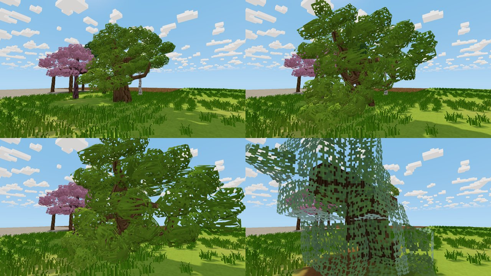

# Falling trees

This is the first, tree-only milestone of `Voxel_Project_Falling_Structures_Claude_Brief.md`.
When you cut through a living trunk or limb, the part that loses its connection
to the roots detaches as one rigid body. It falls and then settles back onto the
voxel grid as resources. The code is in `src/falling.rs`, with hooks in
`app.rs`. The Hot Vampires implementation was not available here, so this was
built from scratch in this project's architecture. Constructed structures and
terrain cave-ins are not included.

Setting: *Settings → Gameplay → Falling trees* (on by default; the host's setting decides).

The images above, in reading order, show 0.6 s, 1.2 s, 2.0 s and 8 s after
cutting the grove oak at its base. In the last image the oak has settled as 131
blocks (resource logs and static leaves); 15 crushed leaves went into an item
drop. That accounts for all 146 detached cells. Render it with
`VOXEL_TREE_PREVIEW=on VOXEL_FALL_PREVIEW=<seconds> cargo test --release render_weather_previews -- --ignored --nocapture`.
No motion clip was recorded.

## Lifecycle and ownership

At any moment, each source cell has exactly one owner:

1. **Attached.** The cell is a world block (living tree wood or leaves).
2. **Detached.** The host clears the cell with ordinary block edits, so clients
   and saves see the removal, and a `Body` owns it as a local offset plus its
   original block. Detached foliage stops swaying at once.
3. **Settled.** The cell becomes a world block again through ordinary edits,
   now as a resource: wood of any species becomes that species' wood
   resource, and leaves become static leaf blocks. Because these are edits,
   the "living" rule (see [TREES.md](TREES.md)) no longer applies: settled
   logs don't grow, don't sway, and never reconnect to a nearby tree.
4. **Fallback.** Any cells that cannot be placed go into one loot drop that
   holds exactly one existing yield per source cell (the same yield as mining
   that block). When the drop list is full, the items merge into the newest
   drop rather than being lost.

## Support

After a host edit removes living wood (`apply_block_edit`), the cell is queued
for a support check. The check is bounded. Starting next to the removed cell,
it follows trunk and branch links: same species, living, face-adjacent. A
component is anchored only if one of its trunk cells stands on real ground
(solid, not leaves, not living wood). Components larger than 1500 cells count
as anchored, so a check can never trigger a huge collapse.

Leaves are payload only. A leaf goes with a detached component when it is
reachable from that component's wood through leaves, within four steps, and
strictly closer to it than to any living wood that stays attached. Ties stay
attached. As a result, touching crowns neither hold each other up nor get
dragged along. Wood that a player placed is never part of a tree: it doesn't
support a tree and doesn't fall with it.

No more than six bodies are active at once. Any extra detached components wait
in a queue, with their cells still in the world.

## Physics (`FallPhysics`)

`SimplePhysics` is a small impulse solver that can be replaced. Every body cell
is a contact sphere against the static voxel world, which is treated as full
cubes:

- Wood spheres have radius 0.45 and leaf spheres 0.12, so a crown compresses
  rather than propping the tree up.
- Contacts use restitution 0.1, Coulomb friction 0.6 and positional correction.
- Mass is 1 per wood cell and 0.12 per leaf, with a full inertia tensor about
  the centre of mass.
- Each frame runs four substeps.
- In water, gravity drops to a quarter and motion is damped.
- A cut body gets a gentle tip away from the cutter, so a perfectly balanced
  trunk still falls.

To switch to Rapier later, implement `FallPhysics::step` (one call per body per
frame, reporting whether it touched ground) and swap the box in
`Falling::default`. Detection, settlement, networking and saving don't depend
on the solver.

## Settlement

A body settles after 0.6 s of calm, supported rest (speed below 0.2 and spin
below 0.15). If it is still moving after 12 s, the attempt is forced. A body
that falls out of the world is converted to a drop.

1. **Rotation.** The 24 proper grid rotations are ranked by how closely they
   align the body's trunk axis with its rest pose, then by overall closeness.
   The first rotation with any valid translation wins, so a tree resting at
   50° settles lying down rather than snapping upright.
2. **Translation.** For each rotation, integer translations are searched
   around the pose: one cell sideways, and four cells down to two up.
3. **Exact mapping.** Each cell offset is transformed exactly; cell positions
   are never rounded one by one. Placement is checked to be one-to-one.
4. **Validity.**
   - Every trunk cell needs a destination that is air, inside the world, in a
     loaded chunk, free of automation devices, and outside every player.
   - At least one placed log must rest on real ground, never on leaves.
   - Limbs and leaves whose destination is occupied are crushed into the drop;
     they never overwrite terrain, buildings, resources or other trees.
   - Among valid candidates, the one that places the most wood wins, then the
     most leaves, then the smallest shift.
5. **Commit.** The placement is written in one frame as host block edits,
   followed by the drop for any crushed cells.

## Saving and multiplayer

- **Saving.** Before the host saves, by F5 or on exit, every falling body is
  settled at its current pose or converted (`resolve_falling`). The save never
  contains both the original tree and a body.
- **Host authority.** The host decides detachment, physics, placement and drops.
  Clients receive a reliable `FallingSpawn` (cell list, original blocks and
  pose; the largest component fits in one packet). Poses then arrive in each
  snapshot, and `FallingEnd` follows when the body finishes. The block edits
  and loot arrive through the existing channels, so clients never choose snap
  positions.
- **Late join.** Players who join later receive a spawn for every active body.

## Validation

Tests in `falling::tests` and `net::tests`:

- Cutting a trunk releases the crown, the trunk above the cut and its limb with
  their leaves, and keeps the stump. The stump stays anchored.
- Cutting a limb releases only that limb and its leaves.
- Two trees whose crowns touch don't hold each other up or get dragged along.
- Placed wood beside a trunk doesn't detach.
- The grid has 24 proper rotations, each one-to-one.
- A cut tree falls, topples and settles on the grid:
  - every destination was air and the mapping is one-to-one;
  - logs placed plus logs crushed, and leaves placed plus leaves crushed,
    equal the source counts;
  - it ends up lying, not standing.
- With no landing space (the only free cells are occupied by a player), the
  result is one drop with exact counts.
- Leaves alone can't hold a settled log up.
- Body meshes keep their tree look and have zero wind. The largest component
  fits one packet, and snapshot poses round-trip.

666 tests pass.

**Cost.** Release build, grove oak with 146 cells: physics plus settlement
takes 0.375 ms per frame. Body meshes are built once at spawn and posed each
frame on the CPU.

## Limits and next steps

- **Physics simplifications.** Bodies don't collide with the player, with
  creatures, or with each other, and the static world is treated as full cubes,
  ignoring shaped slopes. Physics is host-side; clients only display poses and
  don't interpolate between snapshots.
- **No play-through or motion clip yet.** Nothing has been tested in a real
  multiplayer session or recorded in motion.
- **Settled appearance.** Settled wood is the ordinary placed wood cube, not yet
  a dedicated cut-log look.
- **Limbs hold the trunk up.** A large spreading crown can settle with its
  trunk held above the ground by limb logs reaching down. This is supported
  correctly, but can look odd.
- **Leaf orphans.** Leaves more than four steps from any wood, or equally close
  to attached wood, stay where they are.
- **Next.** Constructed structures with role-appropriate connections, after this
  tree case has been played.
