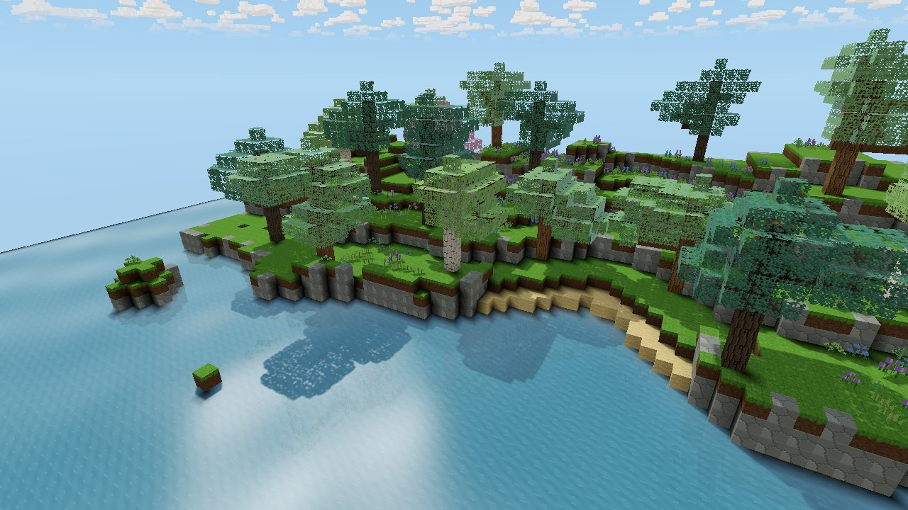
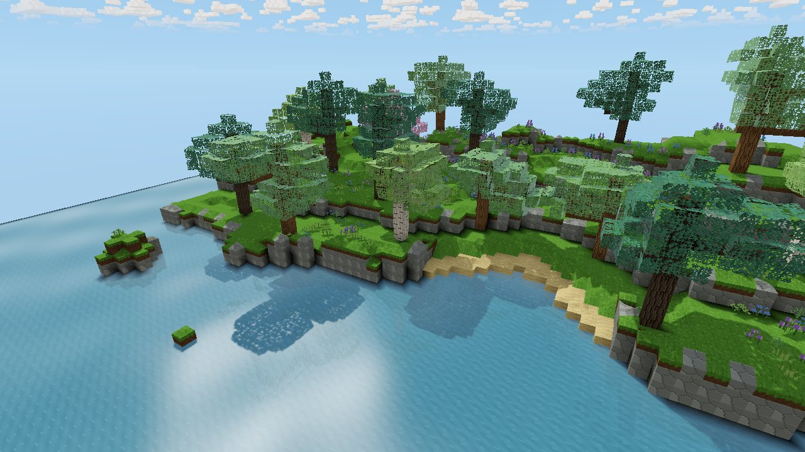
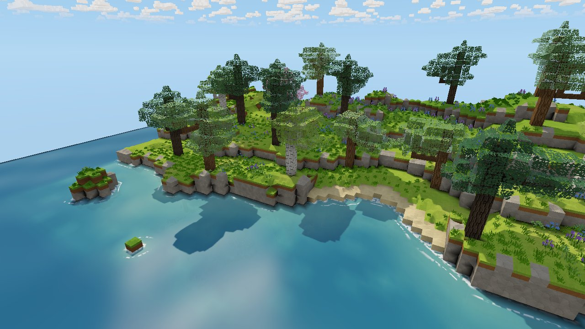
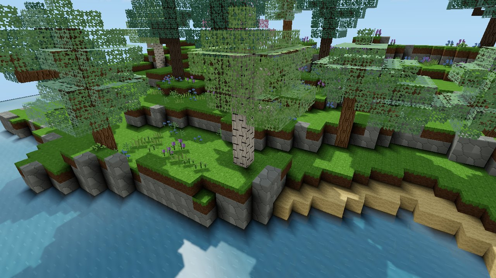
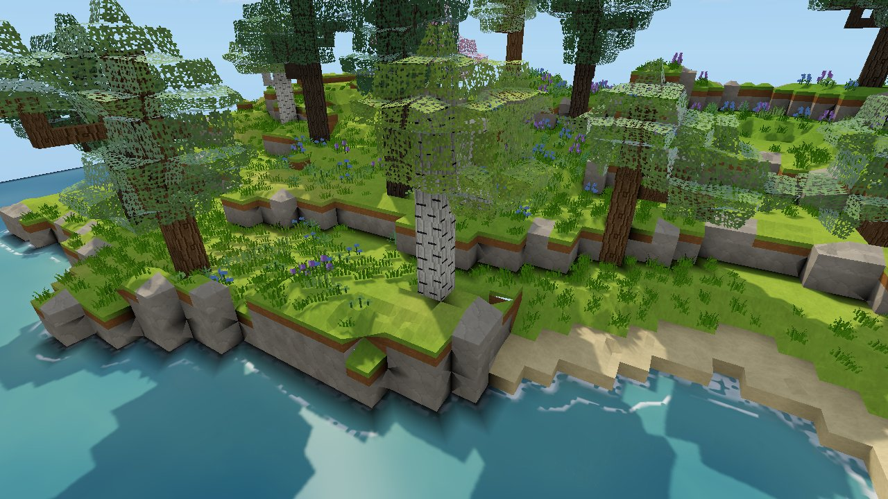

# Natural coast look (experimental)

This pass implements `Voxel_Project_Natural_Coast_Claude_Brief.md`, using
`natural_coast.png` as the art reference: grassy terraces, connected rock
faces, turquoise shallows and shoreline foam. It builds on
[terrain shaping](TERRAIN_SHAPING.md). Everything is presentation only and
switches on and off with the same toggle, **F7** (*Settings → Graphics →
Shaped terrain*). Voxels, digging and placing yields, saves, networking and
collision behave exactly as with shaping alone.

**Test scene.** As host, press **F9** to build the reproducible natural-coast
scene (64 × 48 cells) just ahead of you, with its water surface at your feet
(`src/voxel/coast.rs`). It contains:

- broad terraces whose edges alternate between one-cell grass shoulders and two-cell rock faces;
- a sandy bay and shelving shallows with submerged boulders;
- three islets;
- spaced trees and flower patches.

The scene is built from ordinary replicated block edits, so it is editable and
saved with the world.

## Matched renders

Reference camera: an elevated three-quarter view with the shoreline in the
foreground. The renders are offscreen captures from the same meshes and lighting:
`VOXEL_COAST_PREVIEW=off|on cargo test --release render_weather_previews -- --ignored`.
Add `VOXEL_COAST_CAMERA=1` for the closer, gameplay-distance camera.

| | |
| --- | --- |
| Baseline, cubic  | Shaping only, before this pass  |
| **Natural look**  | |
| Close, cubic  | **Close, natural**  |

## What changed

**Materials** (`natural.rs`, `shader.wgsl`)
- Grass, soil, stone and sand take their albedo from a world-space palette:
  yellow-green grass, ochre soil, warm grey stone with faint strata, and pale
  sand. Low-frequency noise gives large coherent colour areas, never a separate
  colour per cell.
- The shader keeps only 30% of the atlas's pixel contrast (measured against
  the tile's 1×1 mip average) and adds continuous world-space grain.
- Other materials (ores, mud, clay, buildings) keep their textures.

**Grass edges**
- Exposed grass sides show ochre earth under a grass lip (0.22 cells) that
  follows the top edge, including over ramps.
- The lip and earth bands are clipped exactly from the visible face band, so
  faces stay watertight.

**Rock faces**
- Full exposed stone faces are drawn as four flat triangles around an
  off-centre apex, each with its own tilted normal and darker joint rims.
- The faces read as angular stacked blocks. The geometry stays on the cube
  face, so picking, collision and seams are unchanged.

**Water and foam**
- Water top vertices carry depth, shore proximity and seabed colour, computed
  from blocks at mesh time (`water_corner`).
- The shader shows turquoise shallows over a visible seabed, deepening to blue.
  Sky reflections are weaker and the sun glint softer, so the colour stays
  readable.
- Foam (`shore_foam`) is anchored to world space. Broken bands travel toward
  the shore at phases that vary along the coast, with a lacy swash line at
  contact. The band is narrower against rock walls than on beaches.
- Foam pixels skip the screen-space reflection pass.
- Coastal edits update all of this with the normal chunk remesh.

**Water occupancy** is unchanged and separate from rendering: the existing
`World::flood_from` rule still decides flooding. A newly dug cell fills only
when it touches existing water, so an isolated inland pit stays dry and opening
a channel to the sea floods it.

**Foliage**
- Leaf corners pull toward neighbouring leaves, which rounds cube crowns into
  lobes. Corners buried deeper in a crown are darker.
- Colour comes from a per-crown palette: warm greens, deeper spruce, blossom
  cherry.
- Cutout uses a coarser mip, so crowns read as leaf masses with fewer
  pixel-sized holes.

**Growing versus placed leaves** (both modes)
- Only generated foliage sways.
- A leaf recorded in `World::edits` (placed by a player or rule) gets no wind,
  even beside a living tree. This persists through save/load, remeshing and
  rebuilds, because edits are the saved state.

**Ground tufts**
- Grass tufts grow in world-space patches on exposed grass tops.
- They are derived from the cell they stand on, so digging or covering that
  cell removes them in the same remesh. They never float.

**Lighting**
- The natural look warms the sun and cools the sky fill. Depth of field is
  unchanged (the existing setting).

## Validation

Automated tests:

- `natural::tests`: palettes are continuous in world space; shore and depth
  follow the coast; only growing leaves sway (both modes, including a placed
  leaf touching a tree); opening a channel lowers foam proximity at the old
  coast; covering grass removes its tufts.
- `coast::tests`: the scene is deterministic and contains every landform.
- All earlier shaping invariants still pass with natural materials on:
  watertight parity, triangle ownership, chunk order, dig/refill
  reversibility, border remesh, picking and walking.

Decoration triangles (tufts) are excluded from the terrain-surface checks
because they are attachments. 646 tests pass.

Not done:

- No motion clip was recorded. The preview harness renders fixed frames, so
  foam animation and its update after edits have not been seen moving.
- No in-game walking or editing session has been played on the scene.

## Performance

Measured on an RTX 3060 (Vulkan) at 1280×720 with the release build.

| Measure | Cubic | Shaping, before this pass | Natural look |
| --- | --- | --- | --- |
| Meshing, 25 generated chunks (ms/chunk) | 1.62 | 3.62 | 4.97 |
| Triangles, same chunks | 80,548 | 107,919 | 155,200 |
| GPU frame, coast scene, dry (median ms) | 0.84 | — | 0.90 |

Tufts, grass lips and rock facets account for the extra triangles. An edit
remeshes up to nine chunks, nearest first, within the existing per-frame mesh
budget.

## Largest remaining gaps against the reference

1. **Trees.** Crowns are still built from the generator's voxel leaf clusters.
   They read as rounded lobes rather than cubes, but not yet as the
   reference's dense, branching canopies with deliberate gaps. Next step: per
   leaf block, render one irregular foliage cluster mesh (oriented by its
   branch neighbours) instead of cube faces.
2. **See-through water.** Water is drawn in the opaque pass, so the seabed
   colour is carried by the water vertices rather than seen through a
   translucent surface. True refraction needs a separate water pass after
   opaque geometry.
3. **Rock silhouettes.** Rock faces are faceted in shading only. The
   reference's chunky, overhanging blocks would need geometry beyond each
   cell's bounds, or a local variant solver for connected fractures (brief §6).

## Other limits

- Trees built by F9, or placed by rules, are edits, so they count as placed and
  do not sway.
- Water directly beside land on its own layer keeps cube shores; ramps start
  one layer above the water.
- The foam proximity search is three cells wide and uses only the water's own
  layer and the one above.
