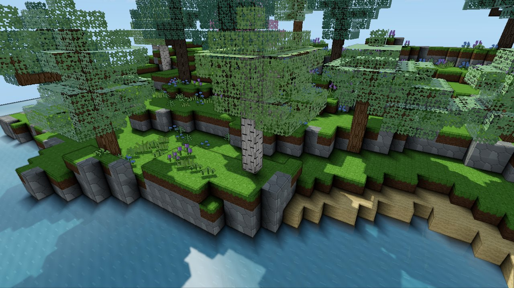
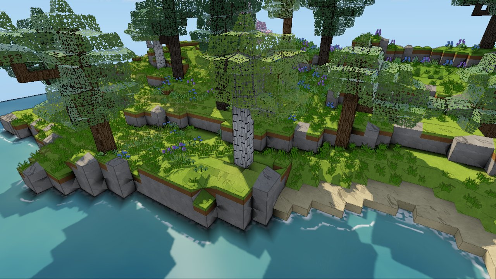

# Stylized look options

There are three independent options under *Settings → Graphics*. All are off by
default, apply immediately, and only change how this player's game looks.
Saves, aiming, collision and multiplayer are unaffected. They combine freely
with each other and with [shaped terrain](TERRAIN_SHAPING.md) /
[the natural coast look](NATURAL_COAST.md).

| Plain blocks | Ink + toon + bevels | With shaped terrain and the natural look |
| --- | --- | --- |
|  |  |  |

## Ink outlines

Code: `ink` in `water_reflections.wgsl`. This runs as part of the existing
full-screen reflection resolve, so it needs no extra pass or render target.

- **Silhouettes:** a pixel draws a line when a neighbour is much farther away
  (relative inverse-depth gap above about 3–7%). Only the nearer side of the
  jump draws.
- **Folds:** inverse depth changes linearly across any flat surface on screen,
  so its second difference is zero on planes. Coplanar block seams draw nothing;
  only real creases do, such as cube edges, ramp folds and terraces.
- **Width:** lines are two pixels wide and fade out between 35 and 100 cells away.
- **Leaves and plants:** cutout leaves (tagged with `LEAF_MARK` in the mesher)
  and swaying plant cards write a 0.96 alpha marker to the scene. The ink pass
  skips those pixels, so texture holes are not outlined. The value stays above
  the reflection pass's 0.95 threshold, so foliage is still reflected in water.

## Toon lighting

Code: `shader.wgsl`.

- **Sun:** direct sunlight (light angle × shadow) snaps to three soft-edged
  bands: shadow, half-lit and full.
- **Shadow side:** ambient fill is flattened and cooled, so lit and shadowed
  sides read as two tones.
- **Unchanged:** water and specular highlights.

## Bevelled blocks

Code: the `Bevel` struct in `mesher.rs`, plus the `World::bevel_blocks` flag.
Toggling the option remeshes loaded chunks.

- **Which blocks:** opaque cube blocks, such as buildings, placed blocks, and
  cubic terrain when shaping is off. In shaped mode, shapeable terrain keeps
  its own forms.
- **Which edges:** an edge is bevelled (0.07 cells) when it is convex: both of
  its faces are exposed and the diagonal cell is open. Each face is inset
  along its convex edges, and a slightly brighter strip joins the two insets so
  edges catch the light.
- **Closing the corners:** corner triangles close three-way corners. A small
  cap closes the notch where a bevel meets a neighbour that doesn't continue it,
  such as a cube standing on a floor.
- **Visual only:** all geometry stays inside the owner cell, and picking and
  collision still use the cube.

## Validation and cost

Tests in `voxel::shaping::tests`:

- With bevels on, the test garden stays watertight. The parity check skips
  only points inside the chamfers themselves.
- A lone cube has exactly 6 inset faces, 12 strips and 8 corner triangles, and
  stays inside its cell.
- A cube on a floor emits one cap under each vertical bevel. Disabling caps
  makes this test fail.

Measured on an RTX 3060 at 1280×720, release build:

| | Plain | Ink + toon + bevels |
| --- | --- | --- |
| GPU frame, coast scene (median ms) | 0.852 | 0.857 |
| Meshing, 25 generated chunks (ms/chunk) | 1.67 | 2.81 (bevels) |
| Triangles, same chunks | 80,548 | 91,978 |

Previews: `VOXEL_STYLE=toon,ink,bevel` (any subset) works with the coast,
garden and landscape preview modes.

## Known limits

- On shaped slopes, ink also traces the internal folds of the surface grid.
  This gives a sketchy, hand-drawn look on bumpy variants.
- Lines fade with distance to avoid noise, so far terrain has none.
- Thin cutout geometry (grass cards) is not outlined.
