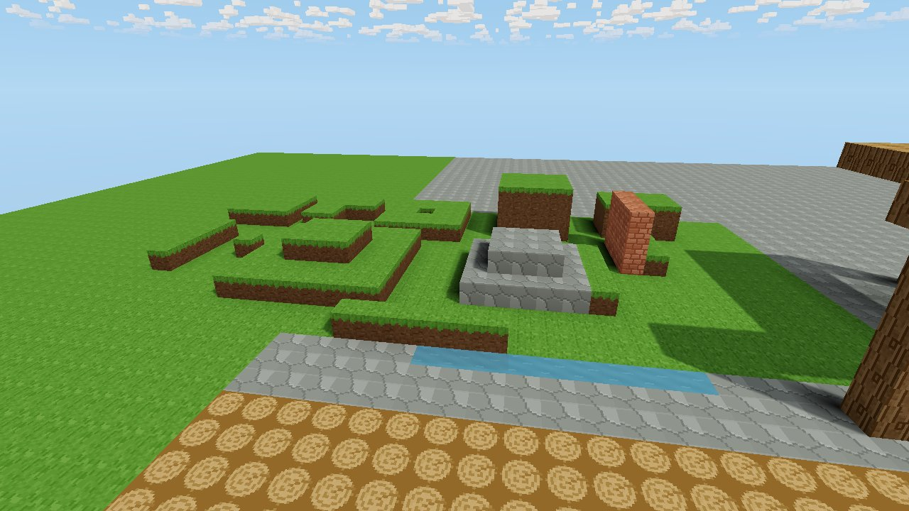
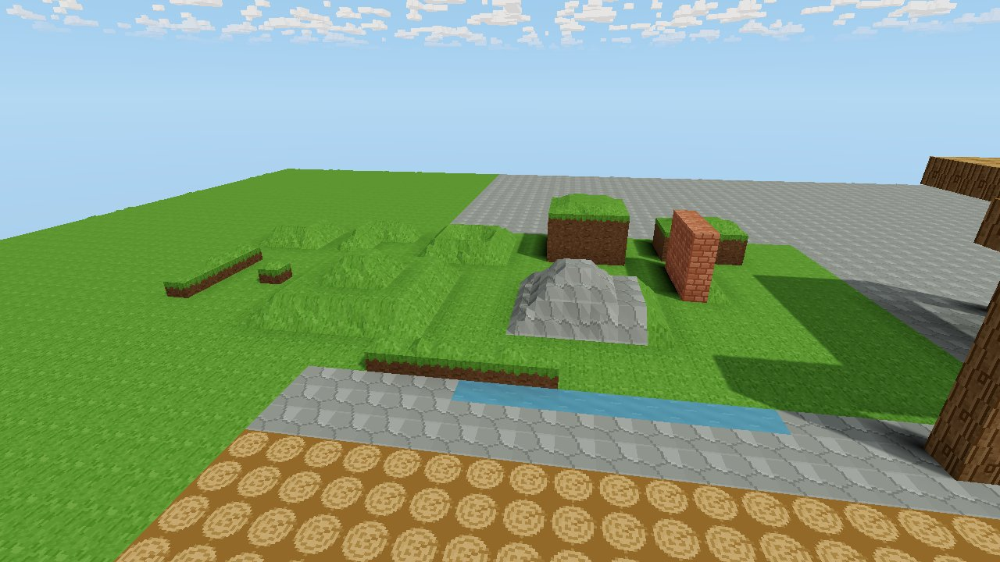
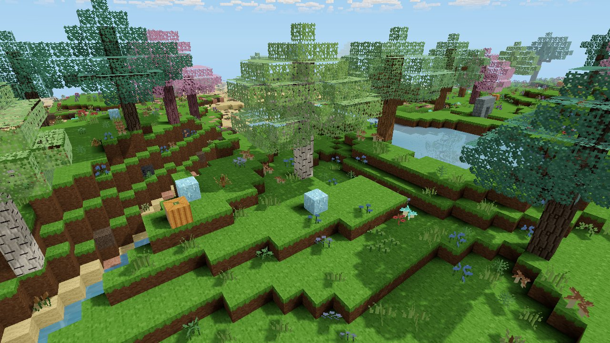
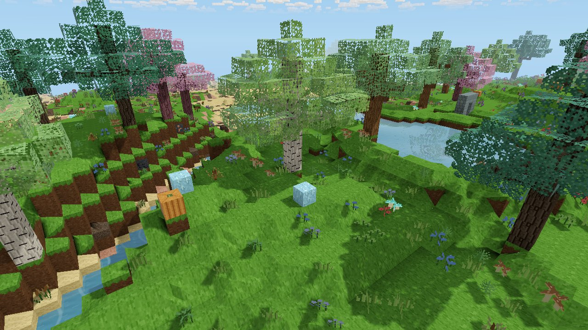

# Neighborhood-driven terrain shaping (experimental)

Implements the brief in `Voxel_Neighborhood_Shaping_Claude_Plan.md`. A local
presentation mode turns exposed terrain cubes into ramps, corners, caps and
rock facets that are derived from neighboring cells. The logical world is
unchanged: one occupied cell is still one block to dig or place.

Toggle with **F7** or *Settings → Graphics → Shaped terrain (experimental)*.
It is off by default. The host can press **F8** to build the terrain test
garden just ahead of the player. The garden is made of ordinary replicated
block edits, so it is saved with the world.

| Cubic | Shaped |
| --- | --- |
|  |  |
|  |  |

The images are matched offscreen renders with the same camera, meshes and lighting:
`VOXEL_SHAPING_PREVIEW=off|on cargo test --release render_weather_previews -- --ignored`.
Add `VOXEL_LANDSCAPE_PREVIEW=hills` to render generated terrain instead of the garden.

## Rules (shaping version 2)

Code: `src/voxel/shaping.rs`. A cell is shaped only when every one of these holds:

- Its material is soil-like (grass, soil, sand, mud, clay, peat, snow) or rock
  (stone, basalt, granite, limestone, marble). Ores, cobblestone, bricks, wood,
  devices and every other block keep their cube.
- Its top is exposed: the cell above is not solid and not water.
- The cell below is a supporting opaque solid, so ceilings and overhang lips stay cubic.
- No water lies in its 3×3 neighborhood on its own layer or the one above. Shores
  stay cubic because water faces are culled against opaque neighbors.

The top becomes a 4×4 height grid (18 triangles) over the full square floor. Each top corner
height depends only on its lattice point, using the four cells that meet there:

| Four cells on the cell's layer | Four cells one layer down | Corner height |
| --- | --- | --- |
| all supporting | — | 1 (flat) |
| any open | all supporting | 0 (ramp down to the lower neighbor's top) |
| any open | any open | 0.6 shoulder (drop of more than one cell) |

Neighbors that share a corner therefore always agree on it, and the result does
not depend on chunk loading or edit order. Architecture and devices count as
support, so terrain meets walls flush instead of ramping away from them.

How many corners are high (at 1) picks the shape:

| High corners | Shape | Fan apex |
| --- | --- | --- |
| 4 | none: plain cube | — |
| 3 | concave corner | corner average |
| 2, adjacent | straight 45° ramp | corner average (planar) |
| 2, opposite | none: saddle fallback to cube | — |
| 1 | convex corner | at least 0.5, to keep volume |
| 0 | cap (isolated cell, ridge, pillar) | 1.0, with every rim raised to at least 0.7 |

The base surface is the fan from the corners to that apex, sampled on the grid.
The grid's rim always stays linear between corners. Each cell then picks a
**variant** from a hash of its world position, and the variant moves only the
four interior grid points, so neighbors and seams are unaffected:

| Variant | Interior points | Look | Materials |
| --- | --- | --- | --- |
| Smooth | unchanged (rock: ±0.12 facet jitter) | plain 45° slope | soil, rock |
| Rounded | +0.14 | bulging shoulder | soil |
| Hollow | −0.14 | scooped, eroded slope | soil |
| Terraced | pulled 85% to their mean | flat ledge between two steep risers (non-smooth) | soil, rock |
| Rocky | ±0.2 jitter | lumpy broken ground (non-smooth) | soil, rock |

Heights stay within 0.05..1. Smooth, Rounded and Hollow soil blends facet
normals 60% toward the cell's mean slope. Terraced blends 15%, and Rocky and
rock keep crisp facets. Shaped tops also get a ±3% (soil) or ±5% (rock)
per-cell brightness variation as a subtle hint of the editable unit.

**Leaves** (shaped mode only, visual only) pick one of five looks per block.
Each look combines a quarter-turn texture rotation, an optional mirror, and a
restrained tint: neutral, shaded deep green, sun-warmed, cool blue-green, or
fresh bright. Every leaf corner is displaced by up to ±0.12 per axis, keyed by
its world lattice point. Faces that share a corner move together, so canopy
outlines turn ragged without cracks. Picking and collision still use the cube.

**Shared faces.** A side face is drawn only in the band between the neighbor's
top-edge profile and the cell's own (`exposed_region`). Both profiles are
linear along the shared edge, so every pairing of shapes, cubes and fallbacks
stays watertight. The band belongs to the higher cell.

## Interaction

- **Picking** (`raycast.rs`): a shaped cell counts as hit only once the ray
  reaches its actual surface. Rays through a ramp's empty part pass on to what
  lies behind. A hit reached from inside an occupied cell's empty part places
  the new block above that cell, never into it.
- **Hover** (`block_target.rs`): the outline follows the shape. It draws the
  floor, corner posts and the whole top grid rather than a cube.
- **Collision** (`player.rs`): shaped cells collide with the exact maximum of
  their surface under the player's footprint. The player climbs rises of up to
  0.6 without jumping and snaps down slopes instead of hopping, so a 45° ramp
  is walkable. Cubic terrain behaves exactly as before.
- **Plants** on a shaped cell root at the surface height of its center.
- **Creatures** are drawn resting on the shaped surface under their footprint
  (`creature::settle_on_shaped_terrain`, `shaping::rest_height`). This is
  display only. Host simulation, AI and hit detection stay on the voxel grid,
  so every viewer's creatures sit on their own terrain whatever their setting.
  Flying, swimming and jumping bodies are not adjusted.
- **Lighting**: shaped surfaces take skylight from the cell above their owner (`shelter.rs`).
- **Invalidation**: a shape reads cells at most two away, which is inside the
  existing 8-cell remesh halo of `World::set_block`. Chunk loads re-dirty all
  neighbors. Shapes are never saved; toggling the mode remeshes loaded chunks.

## Validation

Automated tests in `src/voxel/shaping.rs` and `src/player.rs`:

- Four ramp orientations, convex, concave, cap, ridge, saddle fallback, cliff
  shoulder, overhang, water and wall contact cases.
- A quarter-turn of a neighborhood rotates the shapes to match.
- Watertightness: parity along more than 10,000 axis lines through the whole
  test garden matches the logical solid, in both modes. Disabling partial side
  faces makes this test fail.
- Every triangle has an occupied owner and lies inside that owner's bounds.
- Shapes are identical when chunk insertion and edit order are reversed.
- Digging a ramp changes exactly one cell, and refilling it restores the same geometry.
- An edit on a chunk border dirties and changes the neighboring chunk's mesh.
- A ray through a wedge's empty volume does not select the wedge.
- `max_height_in` matches dense sampling.
- The player walks up and down a ramp with at most two airborne frames. The
  same voxels without shaping form a one-block wall.

**Meshing cost.** Release build, 25 generated chunks, seed 12345, run with
`cargo test --release mesh_cost -- --ignored --nocapture`:

| Mode | ms per chunk | Triangles | Shaped cells |
| --- | --- | --- | --- |
| Cubic | 1.61 | 80,548 | 0 |
| Shaped | 3.62 | 107,919 | 1,934 |

Meshing takes about 2.2× as long, mostly from neighbor shape lookups on buried
cells. Triangles rise by about 34% because each shaped top is 18 triangles
instead of 2. Edits still remesh within the existing per-frame mesh budget.

**Not yet done.** No manual in-game walking test has been run. The playtest the
brief asks for, with a player who doesn't know the rules, also hasn't happened,
so the experience is unvalidated. Treat the decision gate (does the slope look
better, feel right underfoot, and clearly behave as one removable cell?) as open.

## Unsupported cases and limits

- Creature hit boxes and AI still use the voxel grid. Weapon reach is measured
  from up to one cell above a creature's drawn position on a ramp. NPCs and
  remote-player avatars are not settled yet.
- Multiplayer: the toggle is local. Each client shapes and collides its own
  player against its own setting; the host does not check movement.
- Shores, saddles and overhang lips fall back to cubes. Where they meet ramps,
  small triangular side patches show.
- Drops of more than one cell keep a cliff with a 0.6 shoulder. There are no
  gentle multi-cell slopes yet.
- No dig emphasis animation and no placement preview of neighbor reshaping.
- Dirt-to-grass side texturing follows the cell's own top edge only.

## Next improvements

1. Playtest the straight-slope gate in-game, including hover readability with
   and without the outline, and record misunderstandings.
2. Settle NPCs and remote-player avatars the same way creatures are settled.
3. Shape shores by teaching water meshing to emit faces against partial
   neighbors, removing the largest fallback class.
4. Cache shapes per chunk during meshing to recover most of the 2.2× cost.
5. Try wider transitions using several explicitly owned surface cells for gentler hills.
