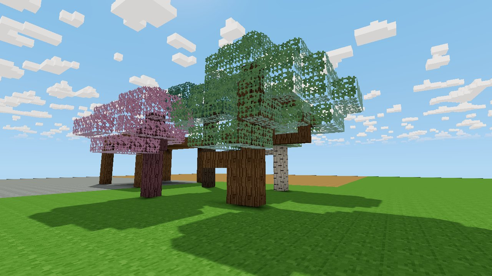
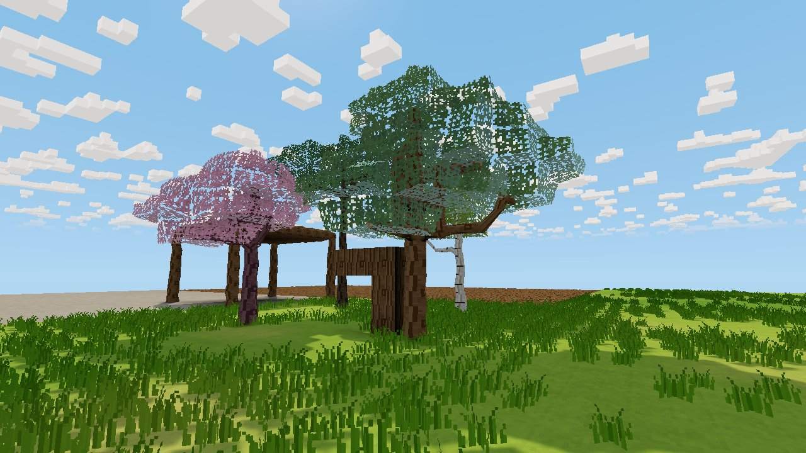
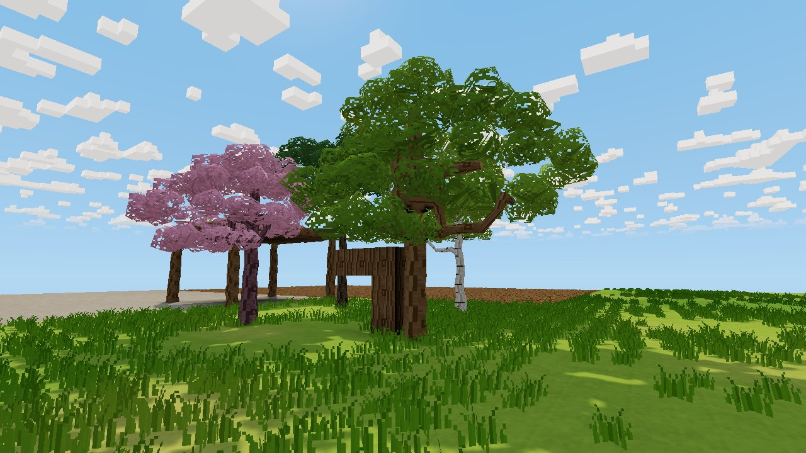
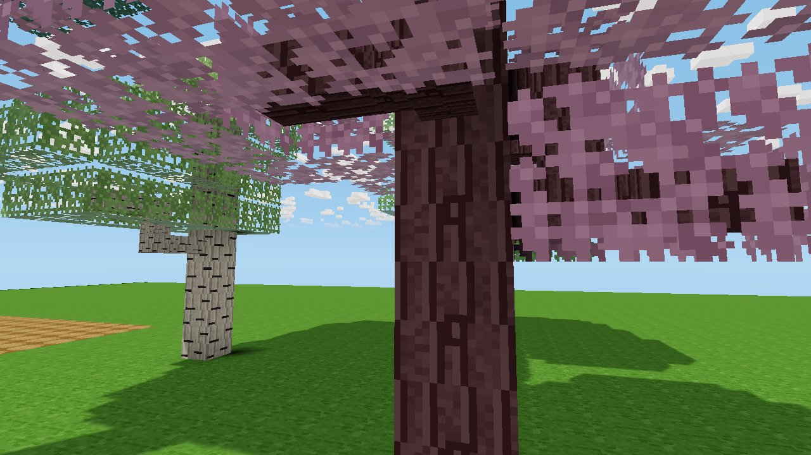
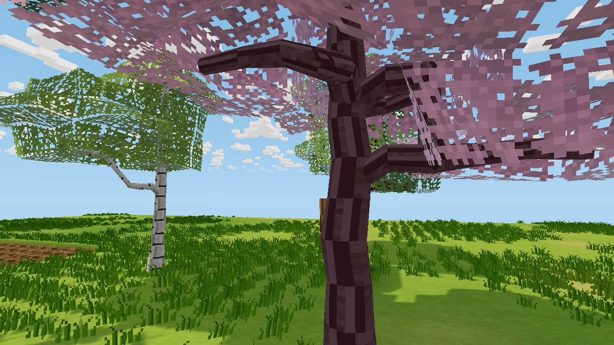
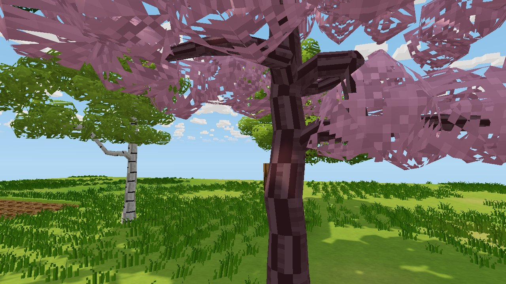
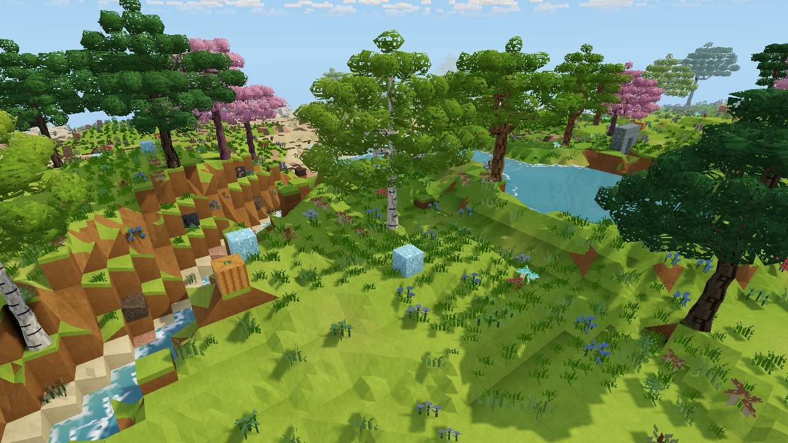

# Organic trees (experimental)

In shaped mode (**F7**), living trees render as round, tapered trunks and limbs
instead of cubes (`src/voxel/organic.rs`). This is the first tree pass from
`Voxel_Project_Material_Shaping_and_Trees.md`. It covers straight trunks with
mild taper, angled limbs and forks, then crowns of foliage clumps.

| | Cubic | Organic trunks | With foliage clumps |
| --- | --- | --- | --- |
| Grove |  |  |  |
| Close |  |  |  |

Generated hills with the whole shaped look:

Render with `VOXEL_TREE_PREVIEW=off|on cargo test --release render_weather_previews -- --ignored`.
`VOXEL_TREE_EYE=x,y,z` moves the camera. The grove has four species and a
player-built oak post and beam touching the oak's trunk.

## Living wood versus construction wood

A wood cell is **living** if it is a branch block (these only come from tree
generation) or trunk wood that is not a recorded edit (`organic::is_living`).
Wood a player or rule places is always an edit, so it stays construction
material and keeps its cube, even when it touches a tree. The rule needs no new
save data and survives save/load, remeshing and network replication, because
edits are the saved and replicated state. This is the same rule that keeps
placed leaves from swaying.

World generation only places wood through its tree generators, so in real worlds
"generated" means "tree". Authored test scenes that write wood as raw chunk
data are the exception (the base render preview has one), and that wood renders
as trees.

## Shape

- **Pieces.** Each living cell is drawn as tube pieces from its centre to a ring
  on every face it shares with a connected living neighbour of the same
  species. Both neighbours build a shared ring from the same face key: same
  centre, radius and irregular cross-section (±9%). Tubes therefore join
  without gaps across cells and chunks.
- **Trunks.** 10-sided, with a radius per species: oak 0.44, spruce 0.33,
  birch 0.27, cherry 0.34. They flare at the ground (+35%, fading over the
  first cells), taper upward to 55%, and lean up to ±0.07 per cell for mild,
  lattice-keyed bends.
- **Limbs.** 6-sided, at 42% of the trunk radius. Where a limb leaves the trunk,
  it starts low inside the trunk and rises out through a collar (radius ×1.35).
  The result reads as a rising bough, not a perpendicular peg.
- **Elbows.** A stepped limb (one horizontal and one vertical link) is a single
  angled piece between the two face rings. Ring vertices are paired after
  rotating one ring's frame onto the other, so the tube doesn't twist.
- **Forks.** Three or more links meet in a rounded knot sized to the thickest piece.
- **Tips and cuts.** A cell with one link continues straight across, tapers, and
  closes with an end-grain disc (the wood's top texture). Removing a
  neighbouring piece turns it into exactly this, so fresh cuts are capped, never
  open.
- **Bounds.** Everything stays inside the owner cell.

Bark wraps once around each ring, using the wood's side texture. Lighting on
round wood is sampled outside the cell, so trunks under a canopy aren't
darkened as if buried. Cells beside a trunk (ground, leaves, placed blocks)
now draw the faces they used to hide against it.

## Crowns

Each exposed living leaf cell renders as one irregular foliage clump
(`push_foliage` in `mesher.rs`): a jittered, slightly flattened low-poly
icosahedron (20 triangles), with leaf-texture cutout edges. Cells buried
inside the crown emit nothing, since they would be hidden anyway.

- **Lobes and gaps.** Clump size follows how many of the 26 surrounding cells
  are leaves: from 0.42 at sparse edges to 0.78 inside. Dense parts merge into
  lobed masses, and sparse ends shrink to sprigs, which opens gaps onto the
  limbs and the sky.
- **Colour.** Crown colour comes from the per-crown foliage palette (warm
  greens; deeper for spruce; blossom for cherry). Clumps deep inside are
  darker, and tops facing the sky slightly lighter.
- **Matte.** Clumps have no sky reflection or sheen, so they don't read as glass.
- **Sway.** Growing foliage sways. Placed leaves keep their static block form
  and never animate, even inside a crown's reach.
- **Picking and collision.** These still use each leaf cell's cube, as before.

## Interaction

- **Aiming.** A ray selects a living cell only where it meets the wood
  (`TreeCell::contains`), so a ray past a trunk's side misses it.
- **Collision.** The player collides with boxes around each piece. Trunks
  still fill most of their cell. Next to a thin limb, the player can stand in
  the cell's empty part, which the cube used to block.
- **Hover.** The outline frames the wood's bounds rather than the cube.
- **Unchanged.** Digging and placing remove or add exactly one cell with the
  existing yields. Tree support and decay rules are untouched.

## Validation

Tests in `voxel::organic::tests` and `player::tests`:
- trunks taper and flare, every ring stays inside its cell, and the top is capped;
- the ring on a shared face is identical from both cells;
- a limb leaves the trunk rising, with a collar, and its tip is capped;
- removing the limb leaves a straight trunk, and removing the trunk above a
  fork leaves a capped cut;
- placed wood stays a cube and doesn't connect to the tree, even when touching it;
- a ray past the trunk's side misses, while a ray at its middle hits;
- the player can stand beside a thin limb where the cube collided, but still
  can't walk into the limb.

Clump tests: a generated 3×3×3 crown draws exactly 26 clumps, with nothing for
the buried centre. Every clump sways and stays near its cell. A placed leaf
next to the crown stays static. 656 tests pass.

## Performance

Measured on an RTX 3060 at 1280×720 with the release build.

| | Cubic | Shaped mode |
| --- | --- | --- |
| Meshing, 25 generated chunks (ms/chunk) | 1.67 | 9.27 (7.08 before trees, 8.04 with trunks only) |
| Triangles, same chunks | 80,548 | 218,695 (154,331 before trees, 176,467 with trunks only) |
| GPU frame, tree grove (median ms) | 0.66 | 1.53 |
| GPU frame, generated hills (median ms) | — | 1.58 |

The GPU figure covers the whole shaped look in that scene: dense grass tufts
over the entire lawn, natural foliage and the trees. It does not isolate the
trees.

## Limits and next steps

- **Trunk width.** Trunks are one cell wide at most (diameter up to about 0.9).
  The very thick trunks in the art reference would need multi-cell trunks from
  the generator, which changes world generation.
- **Collision corners.** Collision uses boxes around pieces, so trunks still
  block about their full cell.
- **Knots.** A knot at a three-way fork is a sphere. Dedicated fork templates
  with blended junction patches would read more naturally.
- **Close-up leaves.** Up close, clump undersides show large leaf-texture
  pixels and shard-like cutout edges. A finer foliage texture, or texture
  repeats inside the clump, would fix it.
- **Crown shapes.** Crown silhouettes still follow the generator's leaf
  clusters (stacked discs on some species). Reshaping crowns into lobes around
  limb ends needs generator changes.
- **Coast scene.** Its trees are built with F9 from edits, so they count as
  placed. They keep block leaves and cube trunks; generated forests show the
  new look.
- **Ink.** Ink outlines treat trunks like any other geometry; trunk rings
  produce no extra lines because the surface is smooth.
- **Next.** The post-and-beam timber junction, then material connections (brief §2 and §4).
